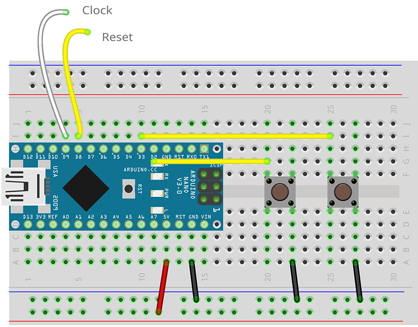

# nano-clock-core - Minimalist Arduino Nano based System Clock Gen

&nbsp;

**nano-clock-core** is the _second_ project in the "phi2" series.

It is based on my "nano-clock" project, but is significantly simplified.  **Nano-clock-core** drops the 4-digit, 14-segement, alphanumeric status display and provides all indicators (run, step, save) using the Arduino Nano's built-in LED.  It can be run with 0, 1 or 2 buttons installed, depending on what features you need; and they can be added temporarily for configuration and then removed for subsequent use.

It still provides a more flexible alternative to [Ben Eater's](https://eater.net) [6502 clock-module](https://eater.net/6502), including multiple selectable clock frequencies (with one button installed), run/stop and single-step operation (with a second button installed), and always issues a CPU reset on power up (if you don't want/need that, then don't connect it).

No build-time changes are needed; buttons can be added/removed while running and it is all handled automatically at runtime.

## Features

- Single-step and Clock modes
- Run/Stop modes
- Selectable frequencies:
  - 1, 2, 4, 8MHz
  - Easy to add additional frequencies
- Auto CPU reset functionality
- Clock Speed/Runnin, Step and Save indications via on-board LED
- Save Settings for start-up

## Usage

### Connecting to your Computer

Ensure you tie the GND (black) busses to the common GND for your computer board.  If you also connect the +5V busses to your computer's supply, it can power both itself and the **nano-clock-cire**.  Then connect the CLOCK pin (9) on the **nano-clock-core** to the clock pin on your computer's CPU/MPU.  In the case of the Ben Eater WDC65C02 based computer, this would be **phi2** (pin 37).

If you want RESET functionality as well, connect the RESET pin (8) on the **nano-clock-core** to the RESET pin on your computer's CPU/MPU.  RESET is a LOW trigger, so the line will be high when not resetting (no pull-up resistor should be required).

### User Interface/Controls

The interface for **nano-clock** comprises 0, 1 or 2 buttons and the built-in LED.  Each button has two functions, driven by a short-press (<999ms) or a long-press (>=1s).  All buttons are optional.

#### Button 1 - Select Frequency | Save Settings

- Short Press

  - If the clock is **running** then short press moves to the next frequency in the sequence (1, 2, 4 and 8 MHz).  At the end of the list of availble frequencies, it jumps back to the first frequency.  While the clock is running, the built-in LED blinks at a rate that indicates the selected clock speed (once per second for 1MHz, 8 times per second for 8Mhz).
  - If the clock is in **STEP** mode, then a short press restarts the clock at the same frequency that was selected when it was stopped.

- A long press will SAVE the currents settings to EEPROM

  - SAVEd settings will be automatically reloaded on RESET or on power ON
  - The LED will flash rapidly to indicate a successful SAVE

  *Note:* If you want **nano-clock-core** to automatically start from cold/reset with the clock RUNNING (which is the default condition), you must perform the SAVE while the clock is in Run mode and RUN is toggled on (LED is blinking).

#### Button 2 - Stop Clock/Step Mode/STEP | Start Clock

- Short press

  - If the clock is **running** then it switches to STEP mode and stop the clock.
  - In STEP mode, the LED stops blinking and each press executes a single clock cycle (LOW, HIGH); the LED lights during the pulse

- A long press restarts the clock at the previously selected frequency.  If the clock is already running, it has no effct.

## Dependencies

A formal dependency list, with minimum versions, will be added here prior to the first stable release, however the basic library dependencies are:

- EasyButton (v2.0.3)

## Building a NANO-CLOCK-CORE

### Components

A minimal number of components are required to assemble **nano-clock**:

- Arduino Nano v3.0 (clones are fine; must match official pinout)

Optionally:

- 1 or 2 6x6mm Momentary Tactile Switches
- 830 Point Solderless Breadboard (or you can mount it directly on your computer's board)

I used an [Elegoo Arduino Nano v3.0](https://www.amazon.com/ELEGOO-Presoldered-Compatible-Arduino-Microcontroller/dp/B0F6Y7GS4Q/), since they are cheap and have a USB-C connector (they have options for other connectors, so verify which version you order).

### Assembly

The breadboard "schematic", above, shows all of the required connections (just +5V and GND if not using buttons).  In an actual build, you can run the non-ground connections to the Arduino Nano *under* the board (since it is on headers) for a cleaner and more secure fit. 

### Programming the Arduino Nano

Install the libraries described in "Dependencies" via the Arduino IDE, connect your board to your computer and choose the appropriate connection and board type ("Arduino Nano"), load the `nano-clock-core.ino` file, and click "Upload".  The sketch will be verified, compiled, and uploaded to your Arduino Nano.

If everything has worked, after a brief pause, the LED display should begin blinking a 1 cycle per second, indicating the default clock speed of 1MHz.

That's it.
