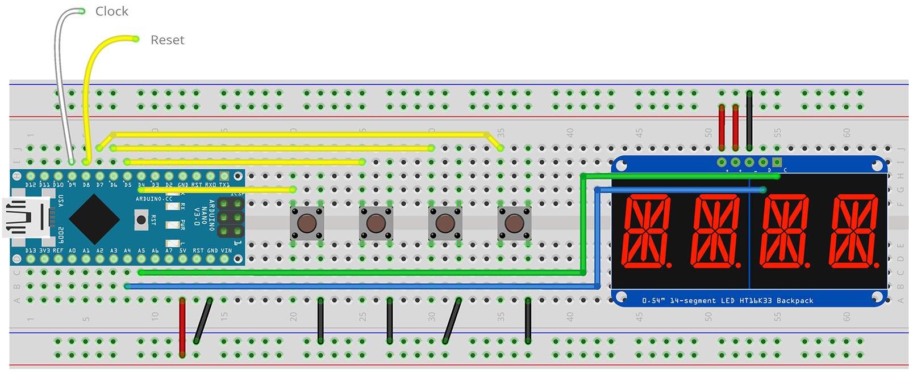
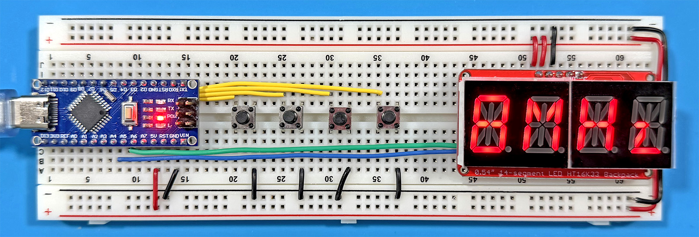

# nano-clock - Arduino Nano based System Clock Gen

&nbsp;

**nano-clock** is the first project in the "phi2" series.

It was built to provide a more flexible alternative to [Ben Eater's](https://eater.net) [6502 clock-module](https://eater.net/6502), both for single-step and slow-cycle operations as well as the ability to replace the final build's 1MHz crystal oscillator while offering faster clock speeds.

## Features

- Single-step and Clock modes
- Run/Stop toggle
- Selectable frequencies across three bands (Hz, kHz and MHz)
  - Hz Band - 1, 2, 5, 10, 25, 50, 100, 250 & 500Hz
  - kHz Band - 1, 2, 5, 10, 25, 50, 100, 250 & 500kHz
  - MHz Band - 1, 2, 4, 8MHz
  - Easy to add additional bands/frequencies
- Auto and manual CPU reset functionality
  - w/ Auto-reset on Start option
- 14-segment 4-character LED status/info display (in keeping with the "retro" theme)
  - Brightness control
  - Clock-Running indication
- Save Settings for Auto-Start

## Usage

### Connecting to your Computer

Ensure you tie the GND (black) busses to the common GND for your computer board.  If you also connect the +5V busses to your computer's supply, it can power both itself and the **nano-clock**.  Then connect the CLOCK pin (9) on the **nano-clock** to the clock pin on your computer's CPU/MPU.  In the case of the Ben Eater WDC65C02 based computer, this would be **phi2** (pin 37).

If you want RESET functionality as well, connect the RESET pin (8) on the **nano-clock** to the RESET pin on your computer's CPU/MPU.  RESET is a LOW trigger, so the line will be high when not resetting (no pull-up resistor should be required).

### User Interface/Controls

The interface for **nano-clock** comprises four buttons and a 4-digit, 14-segment, alphanumeric LED display.  Each button has two functions, driven by a short-press (<999ms) or a long-press (>=1s).  From left to right, the button functions are as follows:

#### Button 1 - Step/Run Toggle | Step vs. Clock Mode

A long press switches between **Single Step** mode (STEP) and **Clock** (CLCK) mode.

Depending on the mode, a short press does one of two things:

- In Step mode, pressing button one generates a single clock pulse.  This is indicated by the periods on the LED display illuminating.
- In Clock mode, it toggles between Run (starting) and Stop (stopping) behavior for the clock.

#### Button 2 - Frequency Select | Frequency Band Select

- A short press steps through the available frequencies in the current frequency band.
- A long press steps through the available frequency bands (Hz, kHz and MHz).

In both cases, if you reach the end of the available frequencies or bands, the next press will take you back to the first.

#### Button 3 - Reset | Auto Reset Toggle

- A short press generates a RESET event (brings the RESET PIN to LOW for the duration specified; default is 2ms per the WDC65C02).
- A long press toggles between RsON and RsOFF, which determine whether a RESET cycle is executed when the nano-clock first powers on.  This is used to allow nano-clock to control initial power on and clock management.  Note that this value only has an effect if it is SAVED.

#### Button 4 - Brightness | Save Settings

- A short press steps through the 16 brightness levels (0 to 15).  There is no "OFF" setting.  Depending on the specific LED module you are using, settings above 8 do not appear meaningfully different.  If you press button 4 when the brightness is 15, it will return to zero.
- A long press SAVEs the current state of **nano-clock** to EEPROM.  This will be reloaded on a reset or power off/on cycle so that **nano-clock** can be used to both reset and initiate operation of a machine without further interaction.

*Note:* If you want **nano-clock** to automatically start from cold/reset with the clock RUNNING, you must perform the SAVE while the clock is in Run mode and RUN is toggled on (frequency display is blinking).

## Dependencies

A formal dependency list, with minimum versions, will be added here prior to the first stable release, however the basic library dependencies are:

- EasyButton (v2.0.3)
- Adafruit GFX Library (v1.12.6)
- Adafruit LED Backpack Library (v1.5.1)

## Building a NANO-CLOCK

### Components

A minimal number of components are required to assemble **nano-clock**:

- Arduino Nano v3.0 (clones are fine; must match official pinout)
- 4x 6x6mm Momentary Tactile Switches
- HT16K33 LED Driver "Backpack"
- 4-digit, 14-segement, 0.54" LED module
- 830 Point Solderless Breadboard

I used an [Elegoo Arduino Nano v3.0](https://www.amazon.com/ELEGOO-Presoldered-Compatible-Arduino-Microcontroller/dp/B0F6Y7GS4Q/), since they are cheap and have a USB-C connector (they have options for other connectors, so verify which version you order).

The KT16K33 backpack and LED module can be purchased as a [preassembled unit](https://www.amazon.com/dp/B0C1C5W7V6), though it will usually require soldering the header pins in place.

### Assembly

The breadboard "schematic", above, shows all of the required connections.  In an actual build, you can run the non-ground connections to the Arduino Nano *under* the board (since it is on headers) for a cleaner and more secure fit.  Similarly, the SDA and SCL connections to the LED display can be run under the backpack PCB.

### Programming the Arduino Nano

Install the libraries described in "Dependencies" via the Arduino IDE, connect your board to your computer and choose the appropriate connection and board type ("Arduino Nano"), load the `nano-clock.ino` file, and click "Upload".  The sketch will be verified, compiled, and uploaded to your Arduino Nano.

If everything has worked, after a brief pause, the LED display should show "1Hz".

That's it.
