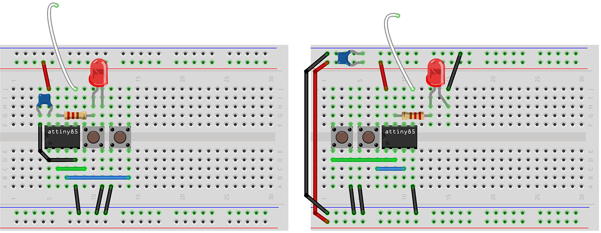

# tiny-clock - Minimalist ATtiny85 based System Clock Gen

&nbsp;

**tiny-clock** is the _third_ project in the "phi2" series.

It is based on my "nano-clock-core" project, itself a significantly simplified variation on my "nano-clock".  In its simplest form, the entire "tiny-clock" system is just a single 8-pin DIP packaged ATtiny85 microcontroller.

It _should_ be run with a 0.1uF ceramic decoupling capacitor connected between GND and VCC, as close to the pins on the chip as possibe.  In practice, I've run it for hours without the decoupling capacitor with no ill effects (provided the computer it is driving has a suitably clean power supply and sufficient smoothing/decoupling across its power rails).

**tiny-clock** retains all the functionality of "nano-clock-core", excepting the RESET function, with the use of optional extra components.  Status is indicated (run, step, save) using a single LED.  It can be run with 0, 1 or 2 buttons installed, depending on what features you need; and they can be added temporarily for configuration and then removed for subsequent use.

It still provides a more flexible alternative to [Ben Eater's](https://eater.net) [6502 clock-module](https://eater.net/6502), including multiple selectable clock frequencies (with one button installed) and run/stop and single-step operation (with a second button installed).

No build-time changes are needed; buttons can be added/removed while running and it is all handled automatically at runtime.

The breadboard on the left is a compact build (e.g., taking the GND from the first switch to the LED instead of running an additional wire); the one on the right is a more conventional layout.  Both yield the same end, functional, result.

## Features

- Single-step and Clock modes
- Run/Stop modes
- Selectable frequencies:
  - 1, 2, 4, 8MHz
  - Easy to add additional frequencies
- Clock Speed/Running, Step and Save indications via on-board LED
- Save Settings for start-up

## Usage

### Connecting to your Computer

Ensure you tie the GND (black) busses to the common GND for your computer board.  If you also connect the +5V busses to your computer's supply, it can power both itself and the **tiny-clock**.  Then connect the CLOCK pin (PB0 or DIP pin 5) on the **tiny-clock** to the clock pin on your computer's CPU/MPU.  In the case of the Ben Eater WDC65C02 based computer, this would be **phi2** (pin 37).

### User Interface/Controls

The interface for **nano-clock** comprises 0, 1 or 2 buttons and the built-in LED.  Each button has two functions, driven by a short-press (<999ms) or a long-press (>=1s).  All buttons are optional.

#### Button 1 - Select Frequency | Save Settings

- Short Press

  - If the clock is **running** then short press moves to the next frequency in the sequence (1, 2, 4 and 8 MHz).  At the end of the list of availble frequencies, it jumps back to the first frequency.  While the clock is running, the built-in LED blinks at a rate that indicates the selected clock speed (once per second for 1MHz, 8 times per second for 8Mhz).
  - If the clock is in **STEP** mode, then a short press restarts the clock at the same frequency that was selected when it was stopped.

- A long press will SAVE the currents settings to EEPROM

  - SAVEd settings will be automatically reloaded on RESET or on power ON
  - The LED will flash rapidly to indicate a successful SAVE

  *Note:* If you want **tiny-clock** to automatically start from cold/reset with the clock RUNNING (which is the default condition), you must perform the SAVE while the clock is in Run mode and RUN is toggled on (LED is blinking).

#### Button 2 - Stop Clock/Step Mode/STEP | Start Clock

- Short press

  - If the clock is **running** then it switches to STEP mode and stops the clock.
  - In STEP mode, the LED stops blinking and each press executes a single clock cycle (LOW, HIGH); the LED lights during the pulse

- A long press restarts the clock at the previously selected frequency.  If the clock is already running, it has no effct.

## Dependencies

The following libraries and "board" definitions are required by the Arduino IDE or CLI:

- [TinyCore (v0.8.0)](https://github.com/MCUdude/TinyCore)
- EasyButton (v2.0.3)

## TINY-CLOCK Performance & Clock Behavior

The available clocks on an ATtiny85 are different, if similar, to those on the ATmega328P on an Uno or Nano.  There is no 16-bit timer on the ATtiny85, but there are many more clock prescaler options; this means that fine tuning higher frequency clock output is much less granular than on an Uno or Nano, but the trade-off would be much finer control at lower frequencies.

Addtionally Timer0 and Timer1 have different operational models, where as on an ATmega328P the principal difference is just in their post-scaler resolution.  Arduino conventions mean using Timer1 for the clock generation to avoid making changes to other timing support functions in the Arduino/board core.

The next upshots of this are a) a slightly more involved clock setup, b) default clocks speed values that aren't as close to the perfect MHz values as the Uno/Nano based clocks here and c) higher jitter.

## Building a TINY-CLOCK

There are three parts to this vs. two (the MCU and firmware) for the **nano-clock** variants; **tiny-clock** adds the requirement for an ISP programmer (see below) to program the MCU.

### Components

A minimal number of components are required to assemble **tiny-clock**:

- ATtiny85

Optionally:

- 0.1uF Ceramic Capacitor
- 220Ω Resistor
- LED
- 1 or 2 6x6mm Momentary Tactile Switches
- 830 Point Solderless Breadboard (or you can mount it directly on your computer's board)

### Assembly

This build is so small, and simple, it can replace the standard 1MHz crystal can.  In fact, other than moving the VCC connection a few columns, it can be a drop-in replacement for the stock BE6502 crystal.

The dimunitive proportions also mean it's possible to add one or both buttons and the status LED to the main BE6502 board, without moving other components - at least if you're willing to run some longer wires for them.  Otherwise, shifting the UART over a bit will free up enough space for the full setup.

You can also do the build on a small breadboard.  For this, the breadboard "schematic", above, shows all of the required connections (just +5V and GND if not using buttons or the LED).

### Programming the ATtiny85

**Unlike** other Arduino builds, which are full boards with USB interfaces, this build uses a "raw" ATtiny85 IC.  To configure and program it, you'll need an "ISP Programmer".  There are many options here, including inexpensive ready-to-run USB programmers, a very simple Arduino Uno based programmer (requires 1x 10uF capacitor, 1x 0.1uF capacitor, a small breadboard, 6 wires, plus an Uno) as well as the "official" programmer.

_While I built my own, I'd recommend buying an "USBtinyISP", which can be had for $15 or less (or ~$20 with a couple of bundled ATtiny85s) as it is less work, and has built-in machined-pin headers for all pins so you don't need to hook-up a breadboard to "do" anything with it._

You'll first need to install the [TinyCore](https://github.com/MCUdude/TinyCore) board in Board Manager.  Then you'll need to setup your programmer settings and choose the clock setup for the ATtiny85.  If you want the four standard clocks speeds, this will need to be set to 8MHz internal osc.  If you use the default 1MHz then you'll get clock speeds 1/8th of what you're expecting.

After which you'll burn the "Urboot" loader; which also sets the required fuses for the above configuration.

Install the libraries described in "Dependencies" via the Arduino IDE, connect your board to your computer and choose the appropriate connection and board type ("ATtiny25/45/85"), load the `tiny-clock.ino` file, Compile it (Verify) and then under the "Sketch" menu choose "Upload Using Programmer".  The programmer settings are in the comments at the start of the .ino file.

If everything has worked, you can remove the ATtiny8 from the programmer and install it into your BE6502.

That's it.

## Alternate ATtinyX5 Considerations

I chose an ATtiny85 here because a) I have bags of them, b) they have enough SRAM and FLASH to be able to use my **nano-clock-core** code as a starting point, and for hobbyist volumes and c) they're not materially more expensive than an ATtiny25.

Some minor optimizations, and replacing EasyButton with simpler, direct, button debouncing, would reduce the RAM footprint so it could fit on an ATtiny45 or ATtiny25.  But, since their cost is so simlar, and they're still 8-pin DIP parts, I didn't feel it was warranted.
